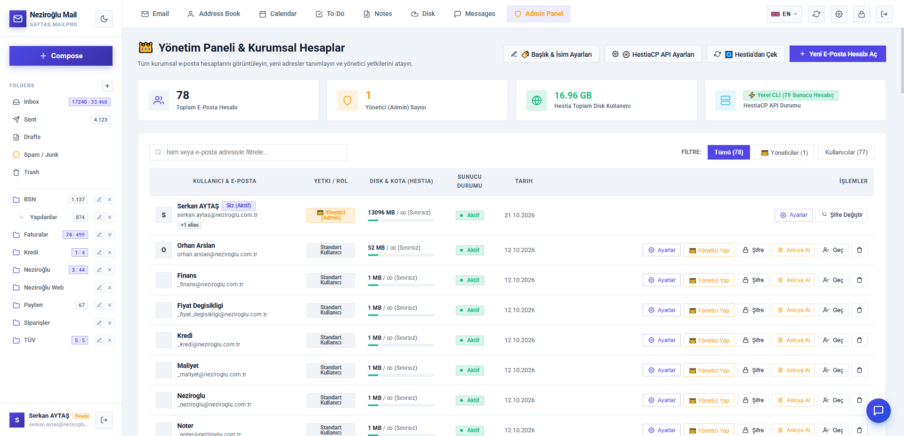
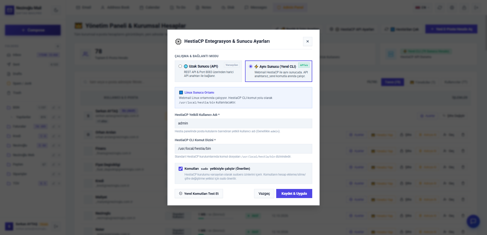

# ⚙️ 2. HestiaCP Sunucu Entegrasyonu / HestiaCP Server Integration

<p>
  <a href="#-türkçe-hestiacp-entegrasyon-kılavuzu">🇹🇷 Türkçe Kılavuz</a> •
  <a href="#-english-hestiacp-integration-guide">🇬🇧 English Guide</a>
</p>

---

# 🇹🇷 Türkçe HestiaCP Entegrasyon Kılavuzu

**Hestia Webmail Suite**, HestiaCP kontrol panelinizle doğrudan haberleşerek webmail arayüzünden çıkmadan:
- Yeni kurumsal e-posta hesabı oluşturma (`v-add-mail-account`),
- Hesap şifresi değiştirme (`v-change-mail-account-password`),
- Kota (MB / Sınırsız) tanımlama (`v-change-mail-account-quota`),
- Takma ad (Alias) ve Yönlendirme (Forwarder) ekleme/silme,
- Otomatik yanıtlayıcı (Autoreply) açma/kapatma,
- Hesap silme (`v-delete-mail-account`)

işlemlerini yapmanızı sağlar. Sistem **iki farklı çalışma modunu** destekler:

---

## Mod 1: Uzak Sunucu / REST API Modu (`remote`) — Port 8083

Webmail yazılımınız HestiaCP'den farklı bir sunucuda/hostingde çalışıyorsa veya standart API anahtarıyla bağlanmak istiyorsanız bu modu kullanın.

### Adım Adım Kurulum:
1. HestiaCP yönetim panelinize (`https://mail.alanadiniz.com:8083`) `admin` hesabıyla giriş yapın.
2. Sağ üstten **Users &rarr; admin &rarr; Access Keys (Erişim Anahtarları)** sekmesine girin ve **Add Access Key** butonuna tıklayın.
3. İzinlerden `ALL` (veya mail komutlarını) seçip kaydedin. Ekranda verilen **Access Key ID** ve **Secret Key** değerlerini kopyalayın.
4. Webmail arayüzünde sol menünün en altındaki **Yönetim Paneli (Admin)** sekmesine girin ve sağ üstteki **Sunucu Ayarları** butonuna tıklayın:
   - **Çalışma Modu:** `Uzak Sunucu (REST API - Port 8083)`
   - **HestiaCP Sunucu Adresi:** `https://mail.alanadiniz.com:8083`
   - **Yetkili Kullanıcı Adı:** `admin`
   - **Erişim Anahtarı ID:** `ACCESS_KEY_ID`
   - **Gizli Anahtar (Secret Key):** `SECRET_KEY`
5. **Bağlantıyı Test Et** butonuna basarak doğrulayın ve kaydedin.

> [!IMPORTANT]
> Eğer HestiaCP güvenlik duvarında API erişimi belirli IP adresleriyle sınırlandırılmışsa, Webmail sunucunuzun IP adresini HestiaCP API beyaz listesine eklediğinizden ve `8083` portunun dış erişime açık olduğundan emin olun.

---

## Mod 2: Aynı Sunucu / Yerel CLI Modu (`local`) — `/usr/local/hestia/bin`

Webmail doğrudan HestiaCP'nin kurulu olduğu Linux sunucuda barındırılıyorsa, Port `8083` veya API anahtarına hiç ihtiyaç duymadan doğrudan `/usr/local/hestia/bin/v-*` komutlarıyla **çok daha hızlı** çalışabilir.

### Sudoers Yetkilendirmesi:
Web sunucusu kullanıcısının (`www-data` veya site kullanıcısı) yalnızca `/usr/local/hestia/bin/*` komutlarını şifresiz çalıştırabilmesi için SSH üzerinden şu komutu çalıştırın:

```bash
# Web sunucusu kullanıcısını öğrenmek için (genellikle www-data veya admin):
ps aux | grep -E 'apache2|nginx|php-fpm'

# www-data kullanıcısına yalnızca HestiaCP bin dizini için NOPASSWD yetkisi verin:
echo 'www-data ALL=(ALL) NOPASSWD: /usr/local/hestia/bin/*' | sudo tee /etc/sudoers.d/hestia-webmail
sudo chmod 440 /etc/sudoers.d/hestia-webmail
```

Ardından Webmail **Yönetim Paneli &rarr; Sunucu Ayarları** penceresinden:
- **Çalışma Modu:** `Aynı Sunucu / Yerel CLI (/usr/local/hestia/bin)`
- **CLI Dizin Yolu:** `/usr/local/hestia/bin`
- **Sudo Kullanımı:** `Aktif (sudo -n)`
seçip kaydedin.

### 📸 Ekran Görüntüleri / Screenshots

#### Yönetim Paneli & Kurumsal Hesap Listesi


#### HestiaCP Entegrasyon & Sunucu Ayarları (Uzak API & Yerel CLI)


---
---

# 🇬🇧 English HestiaCP Integration Guide

**Hestia Webmail Suite** integrates directly with your HestiaCP control panel to manage domain mailboxes (create accounts, change passwords, set quotas, configure aliases, forwarders, autoresponders, and delete accounts) directly from the webmail Administration Panel.

## Mode 1: Remote Server / REST API Mode (`remote`) — Port 8083
1. Log in to your HestiaCP panel (`https://mail.yourdomain.com:8083`).
2. Navigate to **Users &rarr; admin &rarr; Access Keys** and generate a new API Access Key (`Access Key ID` and `Secret Key`).
3. In Webmail, open **Admin Panel &rarr; Server Settings**:
   - Select **Remote Server (REST API - Port 8083)**.
   - Enter `https://mail.yourdomain.com:8083`, username `admin`, your **Access Key ID**, and **Secret Key**.
   - Click **Test Connection** and **Save**.

## Mode 2: Same Server / Local CLI Mode (`local`) — `/usr/local/hestia/bin`
If Webmail is hosted on the same Linux server as HestiaCP, it can execute `/usr/local/hestia/bin/v-*` commands directly without Port `8083` or API keys:

```bash
echo 'www-data ALL=(ALL) NOPASSWD: /usr/local/hestia/bin/*' | sudo tee /etc/sudoers.d/hestia-webmail
sudo chmod 440 /etc/sudoers.d/hestia-webmail
```
Then select **Same Server / Local CLI (`local`)** in **Admin Panel &rarr; Server Settings**.

