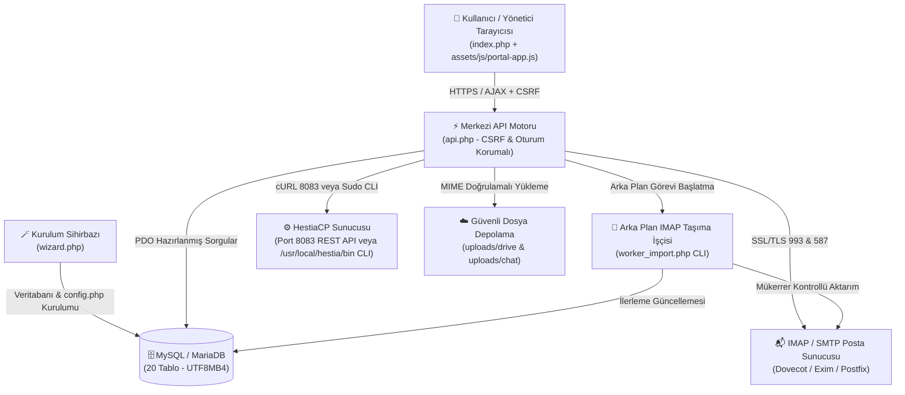
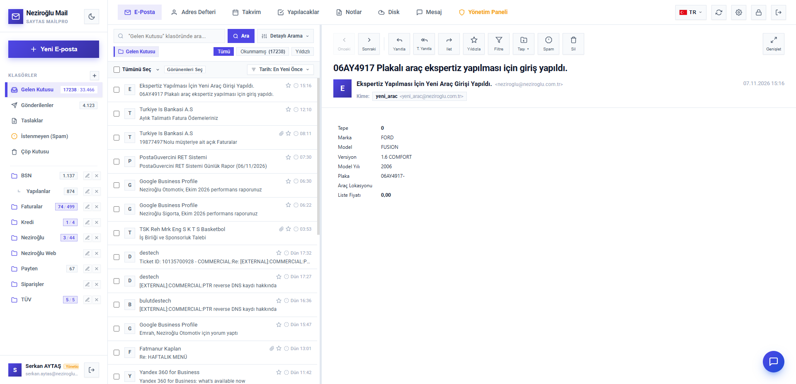
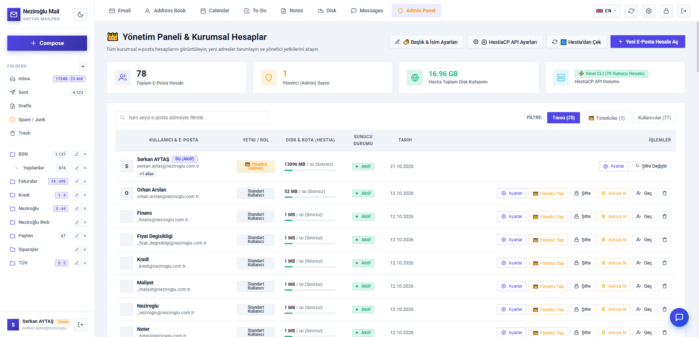
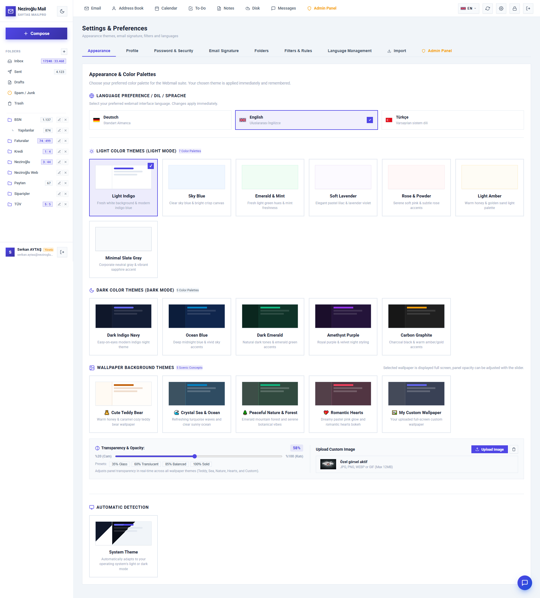

# 📚 Hestia Webmail & Kurumsal Portal Suite — Resmi Wiki / Official Wiki

Hoş geldiniz! Bu Wiki, **Hestia Webmail & Kurumsal Portal Suite** projesinin kurulumu, sunucu yapılandırması, modül kullanımı, veritabanı mimarisi ve güvenlik standartları için kapsamlı **Türkçe (🇹🇷)** ve **İngilizce (🇬🇧)** başvuru kılavuzudur.

Welcome! This Wiki serves as the comprehensive **Turkish (🇹🇷)** and **English (🇬🇧)** reference documentation for installing, configuring, operating, and maintaining **Hestia Webmail & Enterprise Portal Suite**.

---

## 🧭 Wiki İçindekiler / Table of Contents

| # | 🇹🇷 Türkçe Başlık | 🇬🇧 English Title | Sayfa Bağlantısı / Link |
| :--- | :--- | :--- | :--- |
| **01** | **Kurulum Rehberi** (Sihirbaz, Manuel, Apache/Nginx) | **Installation Guide** (Wizard, Manual, Web Server) | [📖 1. Kurulum Rehberi / Installation Guide](1-Kurulum-Rehberi-Installation-Guide.md) |
| **02** | **HestiaCP Sunucu Entegrasyonu** (REST API & Yerel CLI) | **HestiaCP Server Integration** (REST API & Local CLI) | [⚙️ 2. HestiaCP Entegrasyonu / Integration](2-HestiaCP-Entegrasyonu-HestiaCP-Integration.md) |
| **03** | **Modüller ve Kullanım Kılavuzu** (Webmail, Chat, Drive, Takvim) | **Modules & User Guide** (Webmail, Chat, Drive, Calendar) | [🧩 3. Modüller ve Kullanım / Modules & Usage](3-Moduller-ve-Kullanim-Modules-and-Usage.md) |
| **04** | **Veritabanı ve Sistem Mimarisi** (20 Tablo & API) | **Database & System Architecture** (20 Tables & API) | [🗄️ 4. Veritabanı ve Mimari / Architecture](4-Veritabani-ve-Mimari-Database-and-Architecture.md) |
| **05** | **Güvenlik ve Performans** (CSRF, CSS İzolasyonu, SSRF) | **Security & Performance** (CSRF, CSS Scoping, SSRF) | [🛡️ 5. Güvenlik ve Performans / Security](5-Guvenlik-ve-Performans-Security-and-Performance.md) |
| **06** | **SSS ve Sorun Giderme** (Sık Karşılaşılan Sorunlar) | **FAQ & Troubleshooting** (Common Issues & Fixes) | [❓ 6. SSS ve Sorun Giderme / FAQ](6-SSS-ve-Sorun-Giderme-FAQ-and-Troubleshooting.md) |

---

## 🏗️ Sistem Mimarisi Özeti / Architecture Overview



---

## ⚡ Hızlı Başlangıç Özeti / Quick Start Summary

### 🇹🇷 Türkçe
1. Dosyaları sunucunuza klonlayın:
   ```bash
   git clone https://github.com/serkanaytas/hestia-webmail-suite.git .
   ```
2. Yazma izinlerini verin:
   ```bash
   chmod -R 755 uploads/ && chmod 644 config.php
   ```
3. Tarayıcıdan `https://mail.alanadiniz.com/wizard.php` adresine giderek 4 adımlı kurulum sihirbazını tamamlayın.

### 🇬🇧 English
1. Clone the repository into your web root:
   ```bash
   git clone https://github.com/serkanaytas/hestia-webmail-suite.git .
   ```
2. Set directory permissions:
   ```bash
   chmod -R 755 uploads/ && chmod 644 config.php
   ```
3. Visit `https://mail.yourdomain.com/wizard.php` in your browser and complete the 4-step setup wizard.

---

## 🖼️ Arayüz Önizlemeleri / Interface Previews

### 📬 E-Posta İstemcisi (Webmail Inbox & Reader)


### 👑 Yönetim Paneli & HestiaCP Entegrasyonu (Admin Panel & HestiaCP Integration)


### 🎨 Tema ve Çoklu Dil Yönetimi (Themes & Multi-Language)


